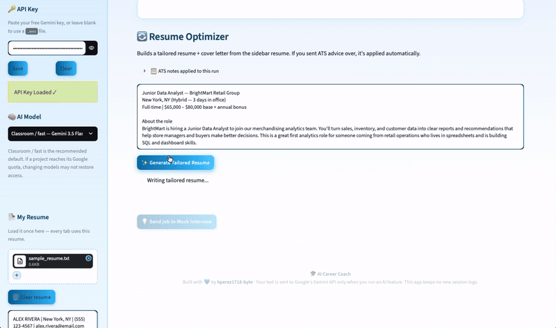

# 🎓 AI Career Coach

A free, open-source AI job-search assistant. Paste a job posting, get an ATS match
verdict, a tailored resume + cover letter, and a full STAR interview prep package —
all built from your own resume.

Built with [Streamlit](https://streamlit.io/) and Google's Gemini API.



## Why this project

AI Career Coach turns a fragmented job-search process into one guided workflow: students load a resume once, assess it against a role, tailor their materials without inventing experience, and rehearse answers for that same role. It is designed as a practical portfolio project and as a classroom-friendly exercise in career readiness.

### Portfolio highlights

- **End-to-end workflow design:** ATS feedback moves directly into resume tailoring and mock interview preparation.
- **Responsible AI guardrails:** prompts prohibit invented experience, skills, certifications, and achievements.
- **Document handling:** accepts PDF, DOCX, and text resumes, then exports polished PDF and Word downloads.
- **Classroom-aware UX:** one resume remains available across tabs for the current browser session, with clear privacy and quota guidance.

---

## How it works

The app runs as a pipeline. Load your resume **once** in the sidebar — every tab uses it for the current browser session.

| Step | Tab | What it does |
|------|-----|--------------|
| 📄 | **Sidebar** | Paste your Gemini API key, then upload (PDF / Word / txt) or paste your resume. A fictional practice resume is included at `samples/sample_resume.txt` for safe demos. |
| 📈 | **Tab 1 — ATS Match** | Paste any job posting. The app extracts the key requirements, checks them against your resume with real keyword matching, and gives a **Match / Not a Match** verdict, a score, why/why not, and coaching tips to close the gap. |
| 🔄 | **Tab 2 — Resume Optimizer** | Generates a tailored resume + cover letter from *your* resume. If you sent the ATS advice over, it's applied automatically — the scan's feedback becomes the rewrite's instructions. |
| 💡 | **Tab 3 — Mock Interview** | Company & culture briefing, personal presentation advice, and **5 interview questions** (technical, behavioral, + a curveball) with STAR-method sample answers drawn from your real background. |

Tabs hand work to each other: **➡️ Send to Resume Optimizer** and
**💡 Send job to Mock Interview** carry the job posting (and ATS advice) forward,
so you never paste the same thing twice.

All AI output can be downloaded as **PDF** or **Word**. Start a new resume or run a new analysis and the app clears related prior results, so students do not accidentally use feedback from the wrong resume or job.

---

## What you need

Everything on this list — nothing else:

- [ ] **Python 3.10 or newer** — [python.org/downloads](https://www.python.org/downloads/)
      (Windows: check **"Add python.exe to PATH"** during install)
- [ ] **This repo's files** — download as ZIP or `git clone` (see below)
- [ ] **Python packages** — installed with one command (`pip install -r requirements.txt`):
  - `streamlit` — the web app framework (the UI)
  - `google-genai` — connects to Google's Gemini AI
  - `python-docx` — generates Word (.docx) downloads
  - `reportlab` — generates PDF downloads
  - `python-dotenv` — loads the API key from a `.env` file (optional)
  - `pypdf` — reads text from uploaded PDF resumes
- [ ] **A free Gemini API key** — [Google AI Studio](https://aistudio.google.com/apikey)
      → sign in → **Create API key** → paste it in the app's sidebar
- [ ] **A web browser** — the app opens automatically at `http://localhost:8501`
- [ ] **Internet connection** — the AI calls go to Google's servers

That's it. No app account, no database, no build step.

> Before publishing: add a short demo GIF or two clean screenshots showing a successful ATS result and the interview-practice view. Do not use a screenshot containing an API key, a rate-limit error, or a real student's resume.

## Setup

> 🖥️ **New to this?** See [SETUP.md](SETUP.md) for step-by-step Windows and Mac
> walkthroughs (installing Python, running the app, troubleshooting).

### 1. Get the code

```bash
git clone https://github.com/hperez1718-byte/ai-career-coach.git
cd ai-career-coach
```

### 2. Install dependencies

```bash
pip install -r requirements.txt
```

### 3. Get a free Gemini API key

1. Go to [Google AI Studio](https://aistudio.google.com/apikey)
2. Sign in with a Google account
3. Click **Create API key**
4. Copy the key

The app defaults to **Gemini 3.5 Flash-Lite**, a lighter high-volume model suited to classroom exercises. You can select Gemini 3.8 Flash in the sidebar when higher-quality output matters more than throughput.

Gemini quotas depend on the Google project and can change. A whole class sharing one project can reach its request or daily quota quickly, so check the project's active limits in [Google AI Studio](https://aistudio.google.com/rate-limit) before class. The app shows the actual quota response and a direct link when Google rejects a request.

### 4. Run the app

```bash
streamlit run app.py
```

### 5. Add your key

Paste the key into the **🔑 API Key** box at the top of the sidebar and hit **Save**.
(Prefer a file? Copy `.env.example` to `.env` and put the key there instead — the
sidebar input always takes priority.)

---

## Usage walkthrough

1. **Sidebar → 📄 My Resume:** upload your resume (PDF, DOCX, or txt) or paste it.
   For a safe demo, upload the fictional `samples/sample_resume.txt` file included in this repository.
2. **Tab 1 → 📈 ATS Match:** paste a job posting, hit **📊 Run Match**. Read the
   verdict, the keyword report, and the coaching tips.
3. **→ Send to Resume Optimizer:** carries the job + ATS advice over.
   Hit **✨ Generate Tailored Resume** — the AI rewrites your resume applying
   exactly what the scan flagged. Download the PDF/Word.
4. **→ Send job to Mock Interview:** hit **🚀 Generate Interview Prep** for the
   company briefing, personal advice, and 5 STAR Q&As. Download the guide.

> ⚠️ **AI honesty rule:** the app is instructed to only reframe what's true —
> it will never invent jobs, skills, or experience. Always review output before
> using it. You own your applications.

---

## Tech stack

- **Streamlit** — UI
- **Google Gemini API** (`google-genai`) — all AI generation, with a
  classroom-oriented default and one model fallback
- **python-docx / ReportLab** — Word and PDF downloads
- **pypdf** — resume text extraction from PDFs
- **python-dotenv** — optional `.env` key loading

---

## Privacy

- No app account or database is required. Your resume and results are held in the active browser session, so download work before refreshing or closing the tab.
- Your resume and job postings are sent to **Google's Gemini API** only when you run an AI feature. The app does not create new session logs.
- Older versions may have created files in `session_logs/`; delete those locally if you do not want to retain them.
- Never commit your `.env` file — `.gitignore` already excludes it.

## Public release and hosting

This repository is intended to be publicly downloadable: people can clone it, add their own Gemini API key locally, and run it on their own computer. The app includes upload-size and text-length limits to keep a local demo lightweight.

Do **not** deploy a public copy and ask strangers to paste API keys into it. In a hosted Streamlit app, submitted keys and resumes pass through the hosting server. A public hosted version should instead use a protected server-side key, authentication, rate limiting, a spending limit, and an appropriate privacy notice. See [SECURITY.md](SECURITY.md) for the full guidance.

## Classroom use

The intended class flow is: load one resume → compare it with a job posting → tailor it → practice interviewing for it. Each student should work in their own browser session and start with `samples/sample_resume.txt` for demonstrations. For real resumes, use only material students are comfortable sending to Gemini, and ensure your school's AI/privacy policy permits it.

For a full class, a shared key is still limited by the quota of its Google project; separate keys from that same project do **not** increase the project's capacity. Plan a small demo, stagger requests, or use a Google project with enough available quota.

---

## Project structure

```
ai-career-coach/
├── app.py              # the whole app
├── requirements.txt    # pip dependencies
├── .env.example        # key template (copy to .env if you prefer files)
├── .gitignore          # keeps .env and logs out of git
└── README.md
```

---

Built with 💙 by [hperez1718-byte](https://github.com/hperez1718-byte)
